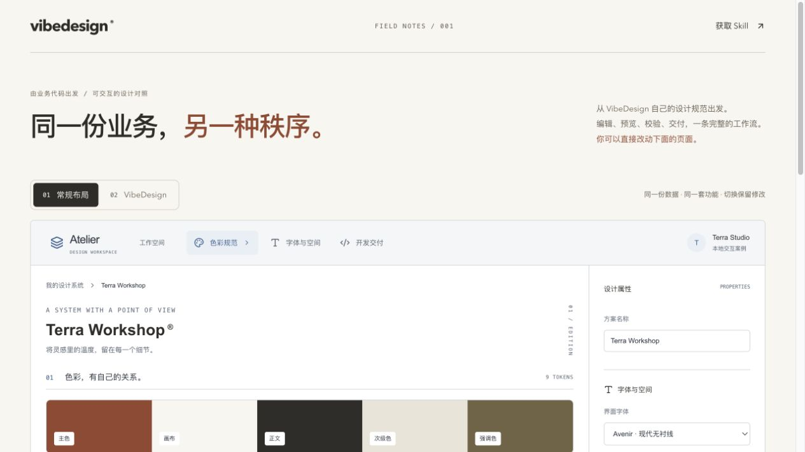
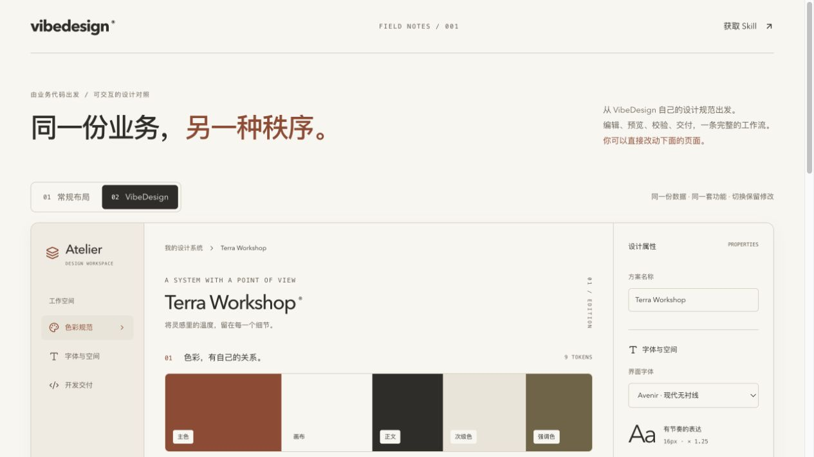

# gmskills

GM 的开源 Skill 集合。每个 Skill 使用 `gms-` 前缀。

- **`gms-vibedesign`**：从产品需求和业务代码生成设计系统与页面。
- **[`gms-img2svg`](skills/gms-img2svg/README.md)**：在本机将图像转换为可编辑 SVG。

**给 AI 编程工作流加上设计规范。** 将产品调性和业务代码转成设计令牌、编码约束与可运行页面。

An agent-native design skill for Codex: turn product intent and business code into design tokens and working UI, using the model already running in your agent. No additional model API key or hosted service is required.

## 安装 gms-img2svg

```sh
npx --yes github:gmleong/gmskills#main install gms-img2svg
```

安装器需要 Node.js 22.18+。执行图像转换还需 Python 和 Cairo；见 [gms-img2svg 安装与使用](skills/gms-img2svg/README.md)。

## 安装 gms-vibedesign

需要 Node.js 22.18+；执行配色校验需要 Python 3。基础 Skill 本身无需启动网站、MCP 服务或安装前端项目依赖。

直接从 GitHub 安装当前发布版本，无需 npm 发布账号：

```sh
npx --yes github:gmleong/gmskills#v0.2.0 install gms-vibedesign
```

默认安装到当前用户的 `~/.agents/skills/gms-vibedesign`，供 Codex 在不同项目中使用。若 `~/.codex/skills/gms-vibedesign` 已有同名 Skill，安装器会识别并沿用。若 Codex 尚未发现 Skill，请重启 Codex。

```sh
# 查看用户级安装状态
npx --yes github:gmleong/gmskills#v0.2.0 status gms-vibedesign

# 仅安装到当前项目的 .agents/skills/gms-vibedesign
npx --yes github:gmleong/gmskills#v0.2.0 install gms-vibedesign --project
```

也可以克隆后运行：

```sh
git clone https://github.com/gmleong/gmskills.git
cd gmskills
node bin/gmskills.mjs install gms-vibedesign
```

重复安装相同内容不会重写文件。更新普通目录前，安装器将完整原目录备份到对应的 `.agents/gms-vibedesign-backups/` 或 `.codex/gms-vibedesign-backups/`，并输出备份路径。符号链接不会被覆盖；链接内容不同时，需要先更新其源目录或自行迁移。`status` 内容一致返回 0，未安装或内容不同返回 1。

本项目尚未发布到 npm registry；请使用以上 GitHub 命令，不要将 `npx vibedesign@latest` 视为当前可用入口。

## 使用

在 Codex 中调用：

```text
$gms-vibedesign 为我的开发者工具生成暖色、清晰、适合长时间使用的设计系统。
```

```text
$gms-vibedesign 读取当前项目的业务代码和数据库定义，沿用已有 API，
生成设计系统并实现订单管理页面，包含筛选、状态修改和空状态。
```

```text
$gms-vibedesign 按项目中的 design-system.json 改进现有页面，
保留业务功能，并验证移动端布局、键盘焦点和实际操作。
```

Skill 引导当前智能体读取项目、推导交互、生成文件并执行相关检查。它不启动第二个模型进程，也不提供独立推理服务；仍需使用者自己的智能体及其模型访问权限。

完整步骤见[使用教程](docs/usage-guide.md)。

## 案例：Terra Workshop

本仓库提供可运行的[设计工作台案例](examples/terra-workshop)。输入是设计系统的数据结构与校验、代码导出逻辑；结果是可编辑的暖色设计页面，并提供功能相同的常规布局对照。两种布局共享组件、状态和操作，切换后保留修改。

| 常规布局 | VibeDesign 设计版 |
| --- | --- |
|  |  |

在仓库根目录运行：

```sh
cd examples/terra-workshop
npm install
npm run dev
```

打开 `http://127.0.0.1:3001`，修改颜色、字体、圆角或留白，观察预览与对比度，再下载设计系统 JSON、Tailwind 配置或 Cursor Rules。输入、页面、样式与初始产物都在案例目录中；手机布局见[截图](examples/terra-workshop/images/mobile.png)。这是项目内部案例，由同一智能体完成，不是客户案例或独立盲测。

## 交付内容

- `design-system.json`：颜色、字体、字阶、间距、圆角与阴影。
- 适配项目的样式配置：Tailwind CSS 3 配置、Tailwind CSS 4 主题变量或已有样式体系。
- `.cursorrules`：引用实际令牌和组件状态的编码约束。
- 页面任务额外交付实际 React 源码与简短交互分析。

未指定输出位置时使用当前项目的 `vibedesign-output/`；明确要求修改现有页面时沿用项目结构。业务字段会结合任务映射成控件和操作，而非机械列出全部后端字段。

## 检查与边界

配色脚本检查四组正文颜色的对比度是否达到 4.5:1：

```sh
python3 skills/gms-vibedesign/scripts/check_contrast.py /path/to/design-system.json
```

这仅验证指定颜色配对，不代表整页通过 WCAG，也不证明页面美观。布局与审美质量取决于输入、宿主模型和实际审查；使用时应检查生成页面的交互、可访问性和工程构建结果。

当前安装器面向 Codex，已在 macOS 验证；其他编辑器和 Windows 尚未实测。VibeDesign Skill 独立于官网和模型 API 服务。

## 开发与贡献

安装器只使用 Node.js 标准库，配色脚本只使用 Python 标准库。克隆后无需 `npm install` 即可运行：

```sh
npm test
npm run test:contrast
```

欢迎通过 Issues 提交可复现的业务场景、失败结果和改进建议。请提供模型、输入、预期与实际效果，并移除业务秘密和个人数据。贡献通过 Pull Request 提交；修改设计规则时附上相关案例，修改安装逻辑时运行安装器测试。

## License

[MIT](LICENSE) · Copyright (c) 2026 gmleong。随附的 VTracer 运行时保留各自的 [许可证和声明](skills/gms-img2svg/scripts/vendor/)。
