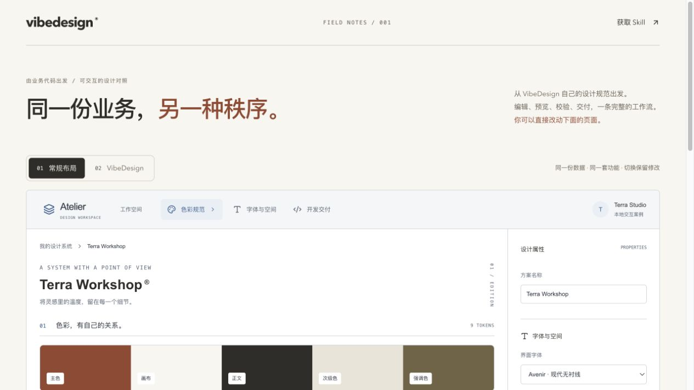
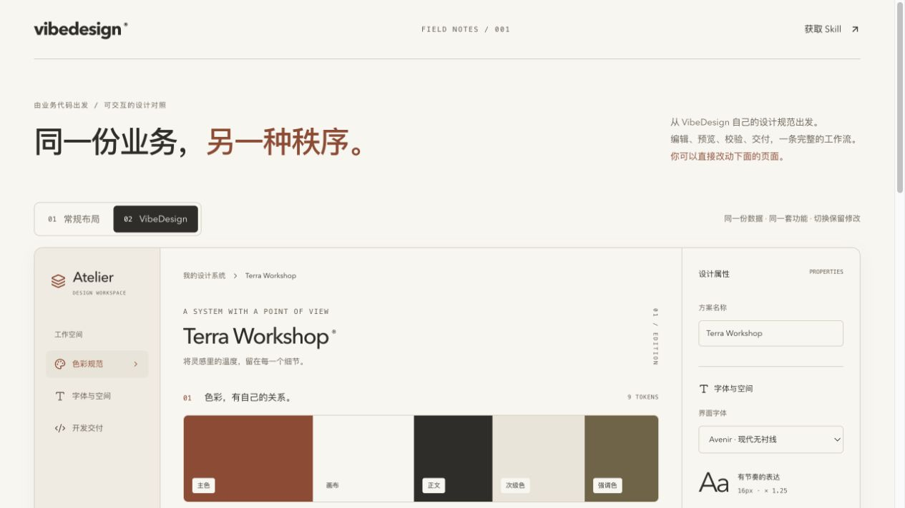

# gms-vibedesign 使用教程

[返回技能目录](../README.md)

VibeDesign 是交给 Codex 执行的 Skill。它指导当前智能体读取项目、生成设计规范与实现页面。需要已有的 Codex 模型访问权限；Skill 本身不需要另一个模型 API Key。

## 1. 安装

准备 Node.js 22.18+ 和 Python 3。用户级安装一次，可在当前用户的不同 Codex 项目中调用：

```sh
npx --yes github:gmleong/gmskills#v0.2.0 install gms-vibedesign
npx --yes github:gmleong/gmskills#v0.2.0 status gms-vibedesign
```

`status` 返回 0 表示当前版本内容一致。若希望只对某个项目生效，在该项目目录执行：

```sh
npx --yes github:gmleong/gmskills#v0.2.0 install gms-vibedesign --project
```

默认用户级目录是 `~/.agents/skills/gms-vibedesign`，项目级目录是当前目录的 `.agents/skills/gms-vibedesign`。安装器也会识别 `~/.codex/skills/gms-vibedesign`：内容一致时直接复用；普通目录更新前完整备份，已有符号链接不会覆盖。安装后如果 Codex 尚未识别 `$gms-vibedesign`，重启 Codex。

也可以克隆仓库，在根目录运行 `node bin/gmskills.mjs install gms-vibedesign`。安装包从 GitHub 获取；本项目未发布到 npm registry。

## 2. 让智能体读取真实输入

在 Codex 打开你的项目，对它说：

```text
$gms-vibedesign 读取本项目已有的业务代码和设计规范，
为订单管理页面生成适配的设计系统并直接实现页面。
保留真实 API 和业务操作；提供筛选、空状态、保存反馈与移动端布局。
输出设计系统、样式配置、Cursor Rules 和页面源码，并完成项目已有检查。
```

如果只有产品想法，可以先让 Skill 生成设计系统：

```text
$gms-vibedesign 为面向自由职业者的客户管理工具建立设计系统：
暖白画布、克制的陶土红、适合长时间阅读。请生成完整令牌、
适合当前项目的样式配置和 Cursor Rules，并校验正文配色。
```

用户指定目录时按指定位置保存；未指定时默认放到项目的 `vibedesign-output/`。需要修改现有页面时，请在提示中写出页面路径和必须保留的功能。

## 3. 检查结果

至少查看四件事：

1. `design-system.json` 中的颜色、字体、字阶、圆角和留白是否符合业务场景。
2. 页面中的可见操作是否真正可用；如果输入仅有数据结构，模拟数据与真实 API 的界限是否写清。
3. 布局在桌面和手机上是否可用，表单标签、焦点、空状态和错误反馈是否完整。
4. 目标项目的类型检查、构建与适用的交互检查是否通过。

Skill 内置的脚本只检查四组正文颜色对比度，阈值为 4.5:1。例如在本仓库根目录检查案例的初始令牌：

```sh
python3 skills/gms-vibedesign/scripts/check_contrast.py examples/terra-workshop/vibedesign-output/skill-case-study/design-system.json
```

它不会自动证明整页符合无障碍标准或具备好的审美。业务页面质量仍需要查看实际界面和交互。

## 4. 运行仓库案例

[Terra Workshop](../examples/terra-workshop/) 用本产品自己的 `types/design-system.ts`、`utils/aesthetic-eval.ts` 和 `utils/design-artifacts.ts` 作为输入，生成了可编辑、可预览、可导出的设计工作台。该目录包含完整 Next.js 页面、样式、初始令牌、Tailwind 配置、Cursor Rules 和对照截图。

| 常规布局 | VibeDesign 设计版 |
| --- | --- |
|  |  |

另见[移动端截图](../examples/terra-workshop/images/mobile.png)。

```sh
git clone https://github.com/gmleong/gmskills.git
cd gmskills/examples/terra-workshop
npm install
npm run dev
```

浏览器打开 `http://127.0.0.1:3001`。先切换“常规布局 / VibeDesign”，再编辑主题名称、颜色、字体、圆角与留白。切换不会丢失当前修改；预览、配色检查和导出文件使用同一份编辑状态。将主色改成过浅的颜色，可以看到对比度失败和导出禁用。测试完停止开发服务，再运行 `npm run build` 检查生产构建。

案例是本项目内部制作的示例，由同一智能体实现两套布局；它不是独立模型对照测试，也不能代表其他业务场景必然取得相同的审美结果。

## 5. 开发与贡献

在仓库根目录运行安装器和配色检查，无需先安装 npm 依赖：

```sh
npm test
npm run test:contrast
```

安装器面向 Codex，已在 macOS 验证。提交 Issue 时，请提供可复现的输入和预期结果，并移除业务秘密和个人数据。
